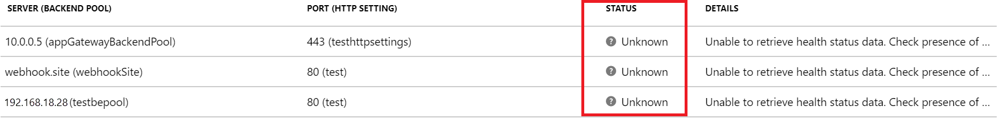
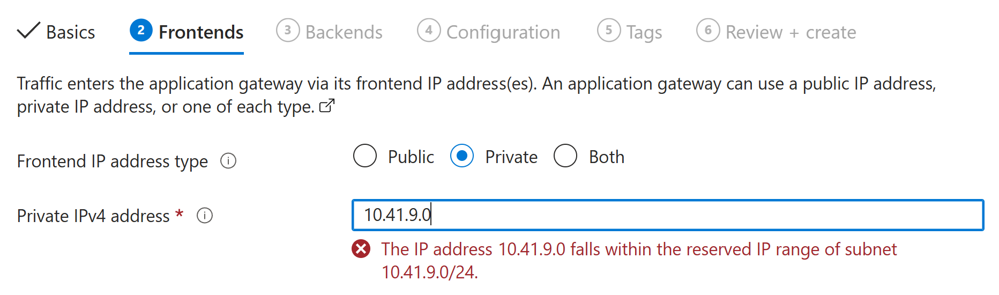

# Application Gateway

Last updated: **{{ git_revision_date_localized }}**

This page explains public and private Application Gateway guidance in the Azure landing zone.

---

## Public Application Gateway

If you use an [Application Gateway](https://learn.microsoft.com/en-us/azure/application-gateway/overview) with a **public** IP address, backend health may show **Unknown**. Internet and private traffic route through the Azure Firewall in the Virtual WAN hub.

To resolve this issue, create a custom **User Defined Route (UDR)**. This route sends traffic to the backend pool through the Azure Firewall in the Virtual WAN hub.

Landing Zone security and governance requirements prevent self-service UDR creation.

Submit a [Service Request](https://citz-do.atlassian.net/servicedesk/customer/portal/3) to the Public Cloud team.

Include this Microsoft guidance in your request:
- [Troubleshoot backend health issues in Application Gateway](https://learn.microsoft.com/en-us/azure/application-gateway/application-gateway-backend-health-troubleshooting#other-reasons)

## Private Application Gateway

Microsoft now supports [private Application Gateways](https://learn.microsoft.com/en-us/azure/application-gateway/application-gateway-private-deployment?tabs=portal) in Azure. If you use a private Application Gateway, backend health should show **Healthy** without additional configuration (for example, custom NSG rules or a UDR).

!!! tip "Access from on-premises"
    If your application is for **internal non-public use**, consider a private Application Gateway. This option avoids additional configuration and keeps traffic within the Azure network.

    This setup also supports access to the Application Gateway from on-premises through existing [MCCS connectivity](../../shared-services/mccs/mccs.md) to Azure, without additional configuration.

To use a private Application Gateway, **register** the `EnableApplicationGatewayNetworkIsolation` feature in your Azure subscription. Follow the latest Microsoft documentation to [register the feature](https://learn.microsoft.com/en-us/azure/application-gateway/application-gateway-private-deployment?tabs=portal#register-the-feature).

!!! warning "Private IP address"
    When you create a private Application Gateway, provide a specific private IP address. The creation process checks whether the address is in the target subnet, but it **does not** check whether the address is already in use.

    

## Security requirements

The following security settings are **required** in Landing Zones:

- Azure Application Gateway must have at least one **Web Application Firewall (WAF) policy** configured
- WAF must be **enabled** for Application Gateway
- WAF on Application Gateway must have **request body inspection** enabled
- WAF policies must use the **Microsoft Default Rule Set (DRS) version 2.2**
- **Bot protection** must be enabled in all Application Gateway WAF policies

The `Application Gateway WAF policy should use Microsoft Default Rule Set` Azure Policy enforces DRS 2.2. The managed rule set type is `Microsoft_DefaultRuleSet`, and the rule set version is `2.2`.

!!! warning "Update existing WAF policies"
    New and existing WAF policies must use DRS 2.2. A deployment fails when the policy uses another managed rule set or version.

DRS 2.2 includes Microsoft threat intelligence protections and updates based on the OWASP Core Rule Set. Review your rule overrides, exclusions, and Paranoia Level settings when you change rule set versions. DRS 2.2 uses Paranoia Level 1 rules by default.

Use the [Application Gateway managed rule set upgrade guide](https://learn.microsoft.com/en-us/azure/web-application-firewall/ag/upgrade-ruleset-version) to upgrade an existing WAF policy. Review your exclusions and custom rule actions after the upgrade. DRS 2.2 changes some rule group names and disables Paranoia Level 2 rules by default.

Review the [rules included in the Default Rule Set 2.2](https://learn.microsoft.com/en-us/azure/web-application-firewall/ag/application-gateway-crs-rulegroups-rules?tabs=drs22%2Cowasp32#default-rule-set-22).

## Related pages

- [Application Gateway overview](https://learn.microsoft.com/en-us/azure/application-gateway/overview)
- [Rules included in Default Rule Set 2.2](https://learn.microsoft.com/en-us/azure/web-application-firewall/ag/application-gateway-crs-rulegroups-rules?tabs=drs22%2Cowasp32#default-rule-set-22)
- [Upgrade an Application Gateway WAF rule set](https://learn.microsoft.com/en-us/azure/web-application-firewall/ag/upgrade-ruleset-version)
- [Troubleshoot backend health issues in Application Gateway](https://learn.microsoft.com/en-us/azure/application-gateway/application-gateway-backend-health-troubleshooting#other-reasons)
- [MCCS connectivity](../../shared-services/mccs/mccs.md)
