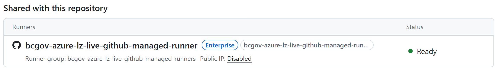

# Continuous Integration and Continuous Deployment (CI/CD) best practices

Last updated: **{{ git_revision_date_localized }}**

## Overview

!!! question "Planning to use across subscriptions?"
    If you plan to deploy the [GitHub self-hosted runners](#github-self-hosted-runners-on-azure) or the [Azure DevOps Managed DevOps Pools](#managed-devops-pools-on-azure) into a different Azure subscription than where your resources will be deployed (ie. in your **Tools** subscription), you will need to [submit a firewall request](https://citz-do.atlassian.net/servicedesk/customer/portal/3) to the Public cloud team. This request should state that you need to allow the self-hosted runners/managed devops pool to access resources in another subscription.

## GitHub Actions

If you are using GitHub Actions for your CI/CD pipeline, consider the following best practices:

- Configure [OpenID Connect (OIDC) authentication](#configuring-github-action-oidc-authentication-to-azure) for GitHub Actions to authenticate with Azure.

- If using [Terraform](https://www.terraform.io/), be aware of the limitations when [creating Subnets](./iac.md#using-terraform-to-create-subnets), and the use of the [AzAPI Terraform Provider](./iac.md#azapi-terraform-provider-using-azapi_update_resource).

- [Self-hosted runners](#github-self-hosted-runners-on-azure) on Azure are required to access data storage and database services from GitHub Actions. Public access to these services is not supported.

<!-- TO DO: Add this section back in when we have tested and verified the GitHub-hosted runners in an Azure VNet.
- [GitHub-hosted runners](#github-hosted-runners-in-an-azure-vnet) can be used in an Azure VNet, but they require additional configuration to ensure secure access to Azure resources. 
-->

### Configuring GitHub Action OIDC authentication to Azure

To allow GitHub Actions to securely access Azure subscriptions, use OpenID Connect (OIDC) authentication.

For detailed instructions, see the [GitHub Actions OIDC Authentication Guide](https://docs.github.com/en/actions/how-tos/secure-your-work/security-harden-deployments/oidc-in-azure).

Here's a quick summary on how to set it up:

1. The GitHub Identity Provider has already been configured in the Azure subscriptions in your Project Set
2. In your Azure subscription:

  - Create an Entra ID Application and a Service Principal
  - Add federated credentials for the Entra ID Application
  - Create GitHub secrets for storing Azure configuration

3. In your GitHub workflows:

  - Add permissions settings for the token
  - Use the [azure/login](https://github.com/Azure/login) action to exchange the OIDC token (JWT) for a cloud access token

This allows GitHub Actions to authenticate to Azure and access resources.

!!! note "New repositories use an immutable `sub` claim format by default"

    Repositories created after July 15, 2026 include the owner and repository IDs in their default OIDC subject (`sub`).
    For branch workflows, the format changes from `repo:ORG/REPO:ref:...` to `repo:ORG@ORG_ID/REPO@REPO_ID:ref:...`.
    GitHub Enterprise Server does not support this format.
    See [GitHub's immutable subject claims documentation](https://docs.github.com/en/actions/reference/security/oidc#immutable-subject-claims).

    Older repositories keep the previous format unless they opt in.
    GitHub also switches repositories to the immutable format after a rename or transfer after July 15, 2026.
    When a repository switches formats, update its existing Azure federated identity credentials to match the new subject.
    Otherwise, Microsoft Entra ID rejects the token exchange and `azure/login` fails.

    Get both GitHub IDs with the GitHub CLI. Replace `OWNER/REPO` with your organization and repository names:

    ```bash
    gh api repos/OWNER/REPO --jq '{repo_id: .id, org_id: .owner.id}'
    # Example: gh api repos/bcgov/azure-lz-samples --jq '{repo_id: .id, org_id: .owner.id}'
    ```

    Set the Entra ID application's federated identity credential `subject` to match the repository's token.
    For a workflow on the `main` branch that does not use a GitHub environment, use these credential settings:

    ```json
    {
      "name": "github-main",
      "issuer": "https://token.actions.githubusercontent.com",
      "subject": "repo:YOUR_ORG@YOUR_ORG_ID/YOUR_REPO@YOUR_REPO_ID:ref:refs/heads/main",
      "audiences": ["api://AzureADTokenExchange"]
    }
    ```

    Replace the placeholders with your GitHub names and numeric IDs.
    These are GitHub IDs, not Azure tenant, client, or subscription IDs.
    If the job uses a GitHub environment, use `repo:YOUR_ORG@YOUR_ORG_ID/YOUR_REPO@YOUR_REPO_ID:environment:YOUR_ENVIRONMENT` as the subject instead.
    For repositories still using the previous format, omit the `@ID` portions.

    Azure requires an exact match for the credential's `subject` field. It does not support `*` wildcards in that field.
    Configure a separate credential for each branch, tag, or environment you need to trust.
    See [Microsoft's federated identity credential guide](https://learn.microsoft.com/en-us/entra/workload-id/workload-identity-federation-create-trust).

### GitHub self-hosted runners on Azure

Microsoft has created an [Azure Verified Module (AVM) for CICD Agents and Runners](https://github.com/Azure/terraform-azurerm-avm-ptn-cicd-agents-and-runners). The Public cloud team has tested this module, and verified that it works within our Azure environment (with a few customizations).

We have created a dedicated/centralized GitHub repository to provide sample Terraform code for creating various application patterns, and various tools. This repository is called [Azure Landing Zone Samples (azure-lz-samples)](https://github.com/bcgov/azure-lz-samples).

You can find the sample Terraform code for deploying self-hosted GitHub runners in the `/tools/cicd_self_hosted_agents/` directory.

!!! info "Pre-requisites"
    Please take special note of the pre-requisites listed in the README file in the `/tools/cicd_self_hosted_agents/` directory. It describes the necessary subnets that the self-hosted runners need to be deployed in.

### GitHub managed runners in an Azure VNet

GitHub supports Azure private networking for GitHub-hosted runners. This allows GitHub-hosted runners to be deployed in an Azure VNet, and securely access Azure resources that are not publicly accessible (ie. resources that are deployed with Private Endpoints, or resources that are deployed in a private subnet).

We have created a centralized implementation of this feature, and have made it available to all projects in the B.C. government Azure environment.

#### How does this feature work?

The GitHub managed runners are deployed in a dedicated virtual network in a centralized Azure subscription. By default, network connectivity to the Landing Zones is **blocked** through the firewall.

!!! question "How to request access to this feature?"
    If you are interested in using this feature, please submit a **firewall request** to the Public Cloud team through [Jira Service Management (JSM)](https://citz-do.atlassian.net/servicedesk/customer/portal/3). Please include the GitHub **repositories** that you want to be able to use the centralized runners from.

!!! warning "BCGov vs BCGov-C Repos"
    Initially, we are only supporting `BCGov-C` repositories for the centralized GitHub managed runners. `BCGov` repositories will not have access to this feature at this time.

Once the appropriate firewall rules have been configured, and your repository has been enabled to use the Runner Group, it will appear under Settings > Actions > Runners > Shared with this repository.



You will then be able to use the GitHub managed runners in your CI/CD pipelines by including the following `runs-on:` configuration in your workflow YAML file:

```yaml
jobs:
  job-name:
    name: Job Name
    runs-on:
      group: bcgov-azure-lz-live-github-managed-runners # GitHub Managed Runners injected into an Azure VNet
    steps:
    - name: Checkout
      uses: actions/checkout@v4
```

!!! info "Runner Specifications"
    Currently, the centralized runners only support the following specifications:

    - Platform: Linux x64
    - Image: Ubuntu Latest (24.04) (GitHub-owned)
    - Size: 
      - 2-cores
      - 8 GB RAM 
      - 75 GB SSD

    For a list of available languages, runtimes, tools, packages, etc. that are available by default with this image, refer to the official GitHub Actions runner images documentation:

    - [Ubuntu Latest (24.04)](https://github.com/actions/runner-images/blob/main/images/ubuntu/Ubuntu2404-Readme.md)

    If you require a different runner specifications, please [submit a request](https://citz-do.atlassian.net/servicedesk/customer/portal/3) to the Public Cloud platform team.

!!! warning "Post centralized runner onboarding"
    After the firewall rules have been configured, you will be responsible for allowing (and blocking) access to your resources from the GitHub managed runners. You can do this through the use of [Network Security Group (NSG)](https://learn.microsoft.com/en-us/azure/virtual-network/network-security-groups-overview) security rules.

    One suggestion is to create a pre-step in your GitHub workflow to retrieve the private IP address of the GitHub managed runner, and then dynamically/on-demand update the NSG rules to allow access to your resources.
    
    After your deployment has completed, you can include a post-step to then remove the NSG rules to block access again.

!!! tip "Example GitHub Workflow"
    We have created an example workflow to demonstrate how to retrieve the private IP address of the GitHub managed runner and dynamically update a Network Security Group (NSG) to allow access to your resources.

    This uses a custom in-house created GitHub Action, called **nsg-jit-rule**. For more information refer to our [azure-lz-actions](https://github.com/bcgov/azure-lz-actions) repository.

## Azure pipelines

If you are using Azure Pipelines for your CI/CD pipeline, consider the following best practices:

- Configure [Azure DevOps Workload identity federation (OIDC) with Terraform](https://devblogs.microsoft.com/devops/introduction-to-azure-devops-workload-identity-federation-oidc-with-terraform/) for Azure Pipelines to authenticate with Azure.

### Managed DevOps Pools on Azure

Microsoft has created an [Azure Verified Module for Managed DevOps Pools](https://github.com/Azure/terraform-azurerm-avm-res-devopsinfrastructure-pool). The Public cloud team has tested this module, and verified that it works within our Azure environment.

We have created a dedicated/centralized GitHub repository to provide sample Terraform code for creating various application patterns, and various tools. This repository is called [Azure Landing Zone Samples (azure-lz-samples)](https://github.com/bcgov/azure-lz-samples).

You can find the sample Terraform code for deploying DevOps Managed Pools in the `/tools/cicd_managed_devops_pools/` directory.

!!! info "Pre-requisites"
    Please take special note of the pre-requisites listed in the README file in the `/tools/cicd_managed_devops_pools/` directory. It describes the necessary resources, and Resource Providers that are required.
